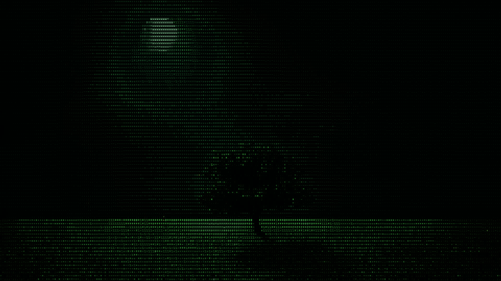
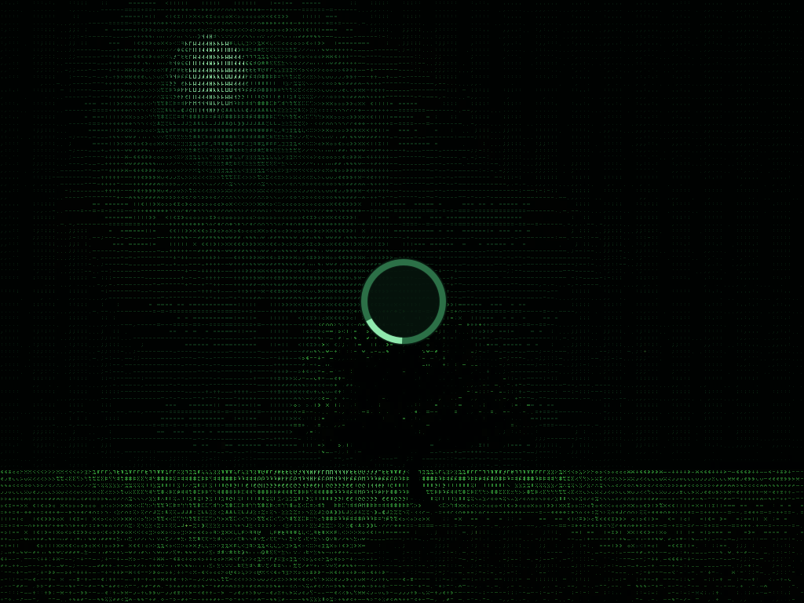

# Verdant

A native Rust / OpenGL ES wallpaper for Niri and other Wayland compositors with layer-shell and viewporter support. The moon, tree, meadow, and shadow from `tree16x9.jpg` become a field of green ASCII characters on near-black. The crown sways, clouds drift, light moves across the grass, and occasional fireflies blink between the characters.

The motion is deliberately gentle. There is no browser, video decoder, terminal emulator, or font service involved.



## Run on NixOS

Run directly from GitHub:

```sh
nix run github:madprogrammer/verdant
```

Or from a checkout:

```sh
nix run .
```

This creates a background layer behind your windows, with no keyboard focus or pointer interception. Stop with Ctrl-C in the launching terminal. The original wallpaper becomes visible again when Verdant exits. If another wallpaper daemon draws above Verdant, stop that daemon in your desktop configuration.

The flake includes `rust-overlay`, a development shell, and a packaged executable with the required library paths. Both flake inputs and Cargo dependencies are locked. Archive inputs use exact Git revisions to avoid GitHub API rate limits while remaining reproducible.

```sh
nix develop
cargo run --release
```

For a short trial:

```sh
nix run . -- --duration 30
```

## Tune the appearance and cost

| Setting | Default | Purpose |
| --- | --- | --- |
| `--fps` | `20` | Frame-rate ceiling, from 1 to 60 |
| `--max-width` | `1920` | Maximum render width; the compositor scales the buffer to its logical output size |
| `--columns` | `240` | Character density, from 80 to 480; fewer columns give larger text |
| `--brightness` | `0.95` | Overall character brightness, from 0.1 to 2 |
| `--speed` | `1` | Animation speed, from 0 to 4; zero draws once |
| `--static` | off | Draw once, then redraw only if the output configuration changes |
| `--output` | compositor choice | One named output per process |
| `--image` | embedded tree | Replacement JPEG/PNG; the scene masks are composed for the original 16:9 tree |

A lighter preset with larger characters:

```sh
nix run . -- --fps 12 --max-width 1280 --columns 160
```

A darker, slower version:

```sh
nix run . -- --brightness 0.65 --speed 0.6
```

List and select monitors:

```sh
nix run . -- --list-outputs
nix run . -- --output Virtual-1
```

For multiple monitors, start one process per output. Output configuration changes resize the rendering surface; a process exits if its selected output is removed. Automatic spawning for newly attached monitors is not implemented. Rendering uses logical output dimensions with a width cap, favoring low resource use over native HiDPI pixel density.

Pause or resume running instances without discarding their last frame:

```sh
pkill -USR1 -x verdant
```

Stop running instances:

```sh
pkill -TERM -x verdant
```

## Niri startup

Build a local executable:

```sh
nix build
./result/bin/verdant --duration 10
```

Add this to your Niri configuration, using the absolute path to this checkout:

```kdl
spawn-at-startup "/path/to/verdant/result/bin/verdant" "--fps" "20"
```

Rebuild after changing the source. The `result` link keeps the package available to Nix garbage collection. An alternative is to install the flake package into your NixOS or Home Manager configuration and use the installed executable. Autostart is intentionally left for you to configure.

## Use the flake package

The flake exposes `packages.<system>.verdant` and `packages.<system>.default` for `x86_64-linux` and `aarch64-linux`, plus matching `apps` outputs.

```sh
nix build github:madprogrammer/verdant#verdant
./result/bin/verdant
```

Add an input to your configuration:

```nix
inputs.verdant = {
  url = "github:madprogrammer/verdant";
  inputs.nixpkgs.follows = "nixpkgs";
  # If your configuration already has a rust-overlay input:
  # inputs.rust-overlay.follows = "rust-overlay";
};
```

Then, in a Home Manager module with `inputs` and `pkgs` available:

```nix
home.packages = [
  inputs.verdant.packages.${pkgs.stdenv.hostPlatform.system}.verdant
];
```

The package installs the `verdant` executable. Configure desktop startup separately as shown above.

## Preview and profiling

Save a deterministic still without connecting to Wayland or changing the desktop:

```sh
nix run . -- --snapshot preview.png --time 12
nix run . -- --snapshot preview-wide.png --width 2560 --height 1080 --time 12
```

The snapshot uses the same two shaders as the wallpaper. It needs an EGL driver supporting a surfaceless display. `--time` sets the animation phase in seconds. The image is center-cropped to fill different aspect ratios.

Measure the process on your own system after a two-second warmup:

```sh
nix develop
cargo build --release
python3 tools/profile.py --seconds 10
python3 tools/profile.py --seconds 10 -- --fps 12 --max-width 1280 --columns 160
python3 tools/profile.py --seconds 10 --pause
```

CPU is reported as a percentage of one logical CPU. RSS includes mapped graphics-driver libraries and buffers; GPU, compositor, and virtualization-host costs are not measured by this script.

## Measured on this machine

NixOS / Niri, 2560×1440 output, Mesa virgl backed by Intel graphics. Measurements on 2026-11-03 exclude a two-second startup warmup; animated samples ran for eight seconds, idle samples for five.

| Mode | Process CPU, one core | Process RSS | Observed rendering |
| --- | ---: | ---: | --- |
| Default: 1920×1080, 20 fps cap | 0.62% | 57.1 MiB | About 19.6 fps |
| Lighter: 1280×720, 12 fps cap, 160 columns | 0.62% | 57.0 MiB | About 11.9 fps |
| Paused | 0.00% | 57.1 MiB | No frames after pausing |
| Static | 0.00% | 57.1 MiB | One initial frame |

These are short process measurements, not whole-system power or GPU benchmarks. The lighter preset reduces the shaded pixel count and frame rate; this short CPU sample did not distinguish the two presets. RSS includes graphics-driver mappings. GPU memory and host-side rendering costs are not included.

A [12-second animated preview](previews/verdant.gif) is also available, captured at 1280×720 with 160 columns and 3.33 fps for a compact GIF. It shows the same animation speed as the live wallpaper; its final-to-first-frame transition is not a seamless loop.

## Rendering design

1. Decode a 1280×720 derivative of your photograph once at startup and upload it. The 260 KiB JPEG is embedded in the executable; the original file is untouched.
2. Evaluate the animated scene into a small RGBA texture: one texel per character, containing its color and glyph index. At the default 16:9 settings this is 240×81 cells, approximately 76 KiB. All trigonometry, image sampling, wind, and firefly calculations happen here.
3. Draw the glyphs at the capped output resolution using two texture reads per pixel. The original 5×7 bitmap alphabet occupies a 128×12 single-channel atlas.
4. Sleep in `poll` until Wayland events or the frame deadline. At most one compositor frame callback is pending. If the compositor withholds callbacks for a hidden or powered-off output, animation stops submitting frames. Whether fully covered wallpapers are throttled depends on the compositor.

There are two full-screen triangle draws per frame, no per-frame image decoding or texture uploads at a stable resolution, no depth buffer, no MSAA, and no CPU rasterization. Paused and static modes retain the last buffer and perform no further draws unless resized. The event loop wakes at most once per second while idle so signal handling remains responsive.

## Lock screen on Sway

Verdant also runs inside [swaylock-plugin](https://github.com/mstoeckl/swaylock-plugin).
Use one instance per locked output:

```sh
swaylock-plugin -f -c 020805 \
  --command-each 'exec verdant --fps 12 --max-width 1280 --columns 200 --brightness 0.75' \
  --inside-color 06140de6 --ring-color 2c7047ff --text-color c5f5d7ff \
  --key-hl-color 8fe8adff --line-uses-inside --separator-color 00000000
```

An [Ubuntu 24.04 amd64 package and build recipe](packaging/swaylock-plugin/README.md)
are provided for systems that need native PAM/SSSD authentication. The locker
uses Ubuntu libraries; Verdant can stay managed by Nix. Rendering and keyboard
indication were verified on two headless Sway 1.9 outputs on Ubuntu using Intel
ARL graphics. Password authentication needs an interactive check on the target.



## Development

```sh
nix develop --command cargo fmt --check
nix develop --command cargo clippy --all-targets -- -D warnings
nix develop --command cargo test
nix build
```

- `src/wayland.rs`: background layer, output selection, frame scheduling, signals.
- `src/renderer.rs`: EGL/OpenGL lifecycle, textures, glyphs, snapshot export.
- `shaders/scene.frag`: photograph mapping, colors, animation, character selection.
- `shaders/ink.frag`: inexpensive full-resolution glyph drawing.

The implementation targets Linux Wayland. Niri is the tested compositor; Windows, macOS, X11, and compositors without layer-shell are not supported. AArch64 has a flake output but has not been tested on hardware.
